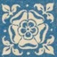
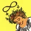
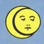
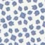
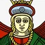
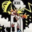
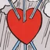

This section covers general technical concepts and the overall philosophy of the Arcana Land project. It assumes that the reader is familiar with beginner tarot concepts such as the 78-card <span class="card">{ .card-icon } Rider-Waite-Smith</span> tradition and the basics of tarot cards.

## Tarot Objects

The fundamental object for Arcana Land is the tarot card which can be uniquely identified through a [canonical identifier](https://github.com/arcanaland/specifications/blob/deck/v2.0-rc.1/DECK.md#31-canonical-ids). These identifiers look something like:

- `major_arcana.08`, which identifies the eigth major arcana card (<span class="card">{ .card-icon } Strength</span> in the Rider-Waite-Smith tradition).
- `minor_arcana.cups.eight`, which identifies the <span class="card">{ .card-icon } Eight of Cups</span> (or the eighth rank of the equivalent suit in a non-Rider-Waite-Smith deck).
- `major_arcana.happy_squirrel`, which identifies a custom card outside of the typical 22 major arcana.

Under this system, a card is a "slot" in a linear sequence of 78 canonical identifiers. What a particular slot means is defined by a [tarot pattern](https://github.com/arcanaland/specifications/blob/deck/v2.0-rc.1/DECK.md#4121-pattern) such as <span class="card">{ .card-icon } Rider-Waite-Smith</span> or <span class="card">{ .card-icon } Marseille</span>. For example `major_arcana.08` refers to <span class="card">{ .card-icon } Strength</span> for Rider-Waite-Smith and <span class="card">{ .card-icon } La Justice</span> for Marseille.

!!! note
    The formal grammar for the identifiers is defined in our [Tarot Deck Specification](https://github.com/arcanaland/specifications/blob/deck/v2.0-rc.1/DECK.md#35-grammar). The full set of identifiers for the canonical 78-card deck are as follows:

    ??? example "List of canonical IDs"
        ```
        major_arcana.00
        major_arcana.01
        major_arcana.02
        major_arcana.03
        major_arcana.04
        major_arcana.05
        major_arcana.06
        major_arcana.07
        major_arcana.08
        major_arcana.09
        major_arcana.10
        major_arcana.11
        major_arcana.12
        major_arcana.13
        major_arcana.14
        major_arcana.15
        major_arcana.16
        major_arcana.17
        major_arcana.18
        major_arcana.19
        major_arcana.20
        major_arcana.21
        minor_arcana.wands.ace
        minor_arcana.wands.two
        minor_arcana.wands.three
        minor_arcana.wands.four
        minor_arcana.wands.five
        minor_arcana.wands.six
        minor_arcana.wands.seven
        minor_arcana.wands.eight
        minor_arcana.wands.nine
        minor_arcana.wands.ten
        minor_arcana.wands.page
        minor_arcana.wands.knight
        minor_arcana.wands.queen
        minor_arcana.wands.king
        minor_arcana.cups.ace
        minor_arcana.cups.two
        minor_arcana.cups.three
        minor_arcana.cups.four
        minor_arcana.cups.five
        minor_arcana.cups.six
        minor_arcana.cups.seven
        minor_arcana.cups.eight
        minor_arcana.cups.nine
        minor_arcana.cups.ten
        minor_arcana.cups.page
        minor_arcana.cups.knight
        minor_arcana.cups.queen
        minor_arcana.cups.king
        minor_arcana.swords.ace
        minor_arcana.swords.two
        minor_arcana.swords.three
        minor_arcana.swords.four
        minor_arcana.swords.five
        minor_arcana.swords.six
        minor_arcana.swords.seven
        minor_arcana.swords.eight
        minor_arcana.swords.nine
        minor_arcana.swords.ten
        minor_arcana.swords.page
        minor_arcana.swords.knight
        minor_arcana.swords.queen
        minor_arcana.swords.king
        minor_arcana.pentacles.ace
        minor_arcana.pentacles.two
        minor_arcana.pentacles.three
        minor_arcana.pentacles.four
        minor_arcana.pentacles.five
        minor_arcana.pentacles.six
        minor_arcana.pentacles.seven
        minor_arcana.pentacles.eight
        minor_arcana.pentacles.nine
        minor_arcana.pentacles.ten
        minor_arcana.pentacles.page
        minor_arcana.pentacles.knight
        minor_arcana.pentacles.queen
        minor_arcana.pentacles.king
        ```

## Tarot Decks

A tarot deck is a directory of card images and a `deck.toml` file with metadata. For example, consider a 2-card tarot deck that contains just <span class="card">{ .card-icon } The Tower</span> and the <span class="card">{ .card-icon } Three of Swords</span> (how fun!) with images that are 1200px tall.

```console
└── my-deck
    ├── deck.toml
    └── h1200
        ├── major_arcana
        │   └── 16.png
        └── minor_arcana
            └── swords
                └── three.png
```

The image for <span class="card">{ .card-icon } The Tower</span> with canonical identifier `major_arcana.16` is placed in `h1200/major_arcana/16.png` and the image for the <span class="card">{ .card-icon } Three of Swords</span> is at `h1200/minor_arcana/swords/three.png`.

```toml title="deck.toml"
[deck]
name = "My Deck"
identifier = "org.example/deck/my-deck"
creator = "Jane Doe <jane@example.org>"
version = "1.0"
schema_version = "2.0"
```

Check out the full [Tarot Deck Specification](https://github.com/arcanaland/specifications/blob/deck/v2.0-rc.1/DECK.md) to see the full range of crazy tarot decks that can be represented, from decks that have extra majors, extra suits or completely custom oracle decks.
