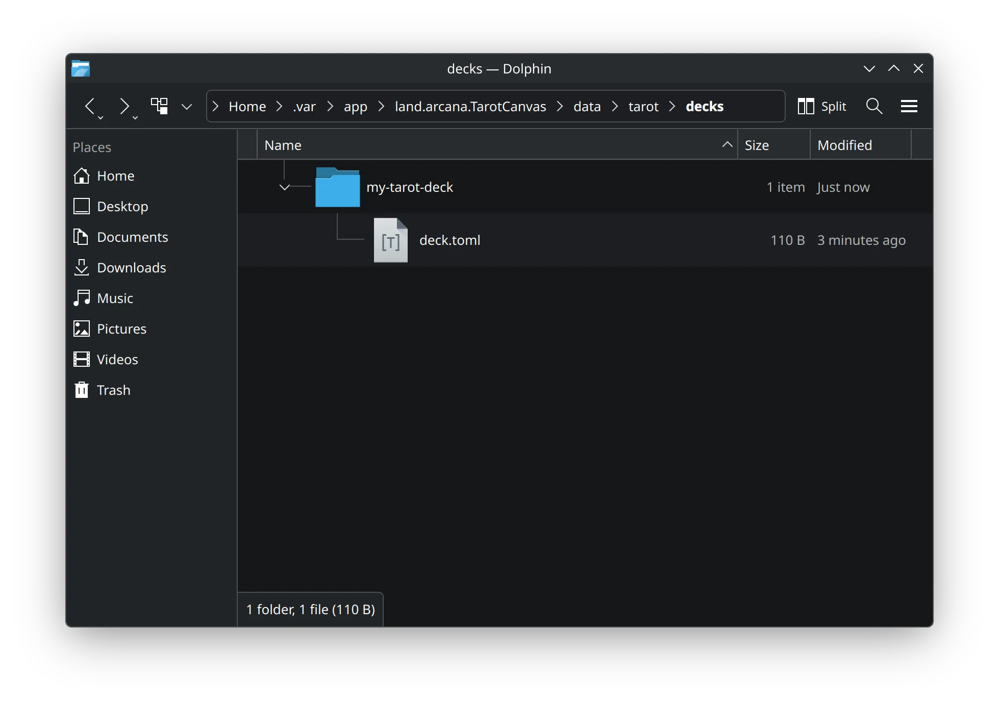
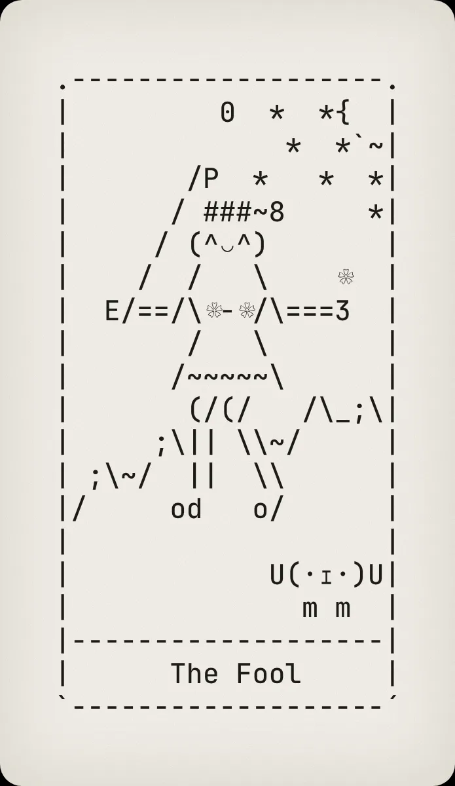
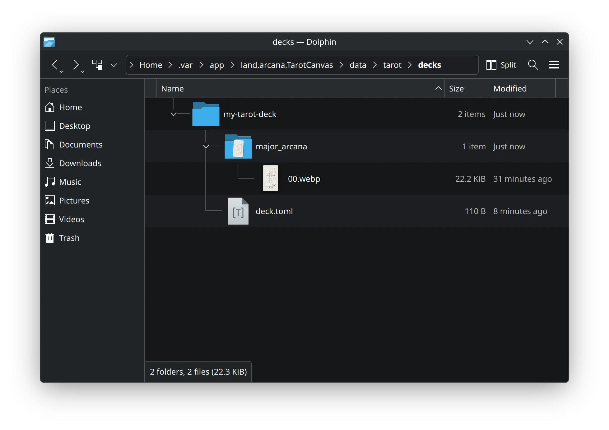
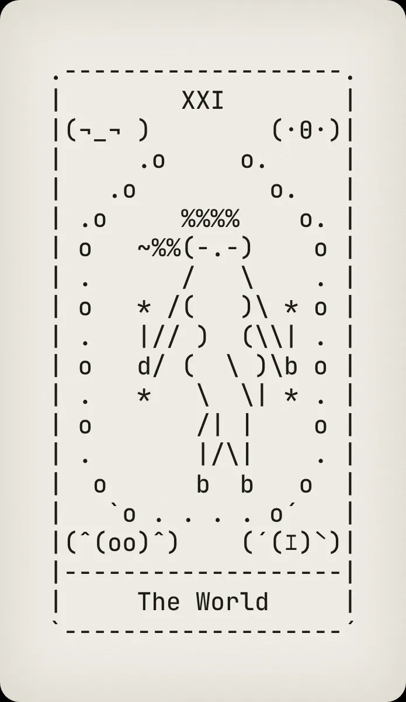
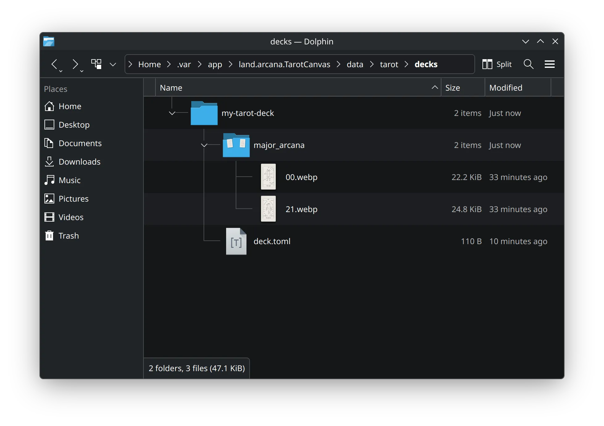
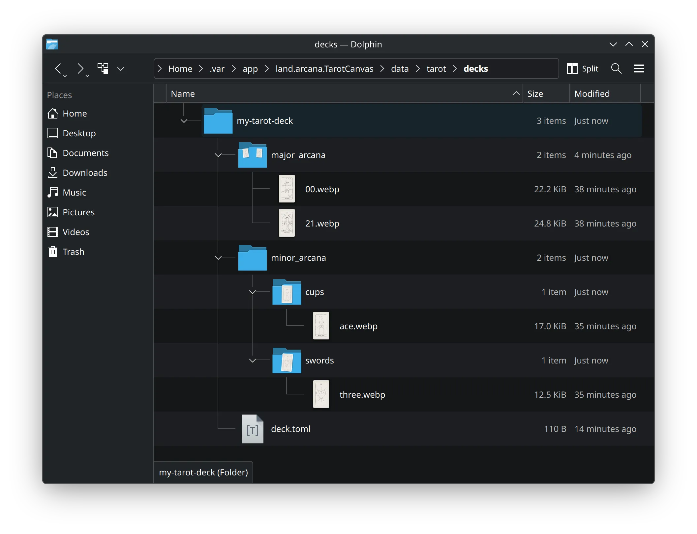
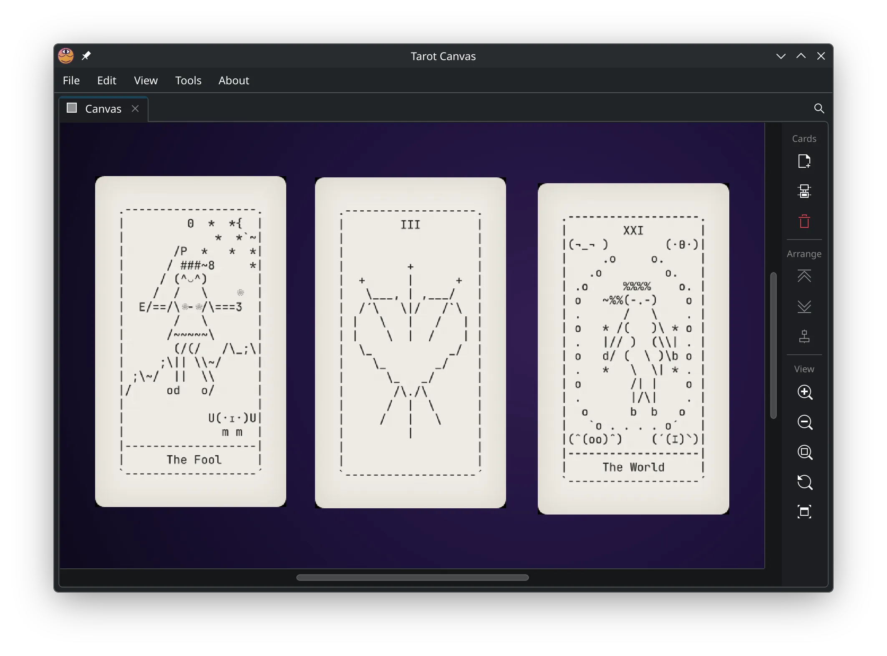
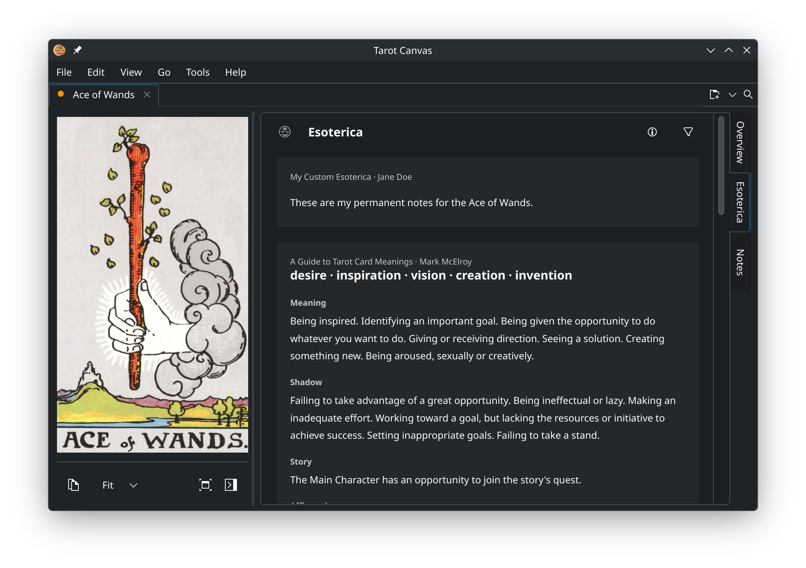

# Frequently Asked Questions

## 1. Where Can I Get Other Tarot Decks?

Arcana Land provides a small number of free tarot decks (as of 2026, four) in our [Reference Deck Collection](https://github.com/arcanaland/reference-decks/releases). They are all available for download directly in the Tarot Canvas app.

Because there are only a handful of tarot decks in existence that are verifiably free from copyright claim, we are only able to provide a small sample of decks that are permissively licensed. For other decks, you can create your own by following the next section.

## 2. How Do I Make My Own Deck?

Creating a Tarot deck consists of putting your card images into a certain folder structure with a TOML file at the top.

This section will walk-through creating a tarot deck step-by-step using KDE Plasma.

Open Dolphin and navigate to `~/.var/app/land.arcana.TarotCanvas/data/tarot/decks`. Create a directory called `my-tarot-deck` (or name it whatever).

Then create a new TOML file called `deck.toml` and fill it out:

```toml
[deck]
schema_version = "2.0"
name = "My Tarot Deck"
author = "Jane Doe"
version = "1.0"
identifier = "com.example/deck/my-tarot-deck"
```



For this example, I will be using images from Kathryn Isabelle Lawrence's [ascii-tarot](https://github.com/lawreka/ascii-tarot).

Place major arcana images in a folder called `major_arcana` and name them as a two-digit number. For example, The Fool:



Place it in `major_arcana/00.webp`.



Another example of The World:



Place it in `major_arcana/21.webp`.



For the minor arcana, create a folder named `minor_arcana` with subfolders `wands`, `cups`, `swords`, and `pentacles`. For example:



Follow the example of `minor_arcana/cups/ace.webp` and `minor_arcana/swords/three.webp` for the rest of the cards.



You should now be able use the canvas view with "My Custom Tarot" selected in the Card Explorer's dropdown. Summoning random cards will then draw from your personal deck.


!!! tip
    Refer to the full [Tarot Deck Specification](https://github.com/arcanaland/specifications/blob/main/DECK.md) ([PDF](https://github.com/arcanaland/specifications/releases/download/deck%2Fv2.0-rc.1/deck-v2.0-rc.1.pdf)) for more details about the file and directory format.

!!! note
    I personally scan my decks using an app that I am developing called [deckle](https://github.com/arcanaland/deckle). It is a command-line tool that handles the scanning, physical jig creation, image cropping, deskeweing and cataloging. It is pre-alpha, but if you are technical and adventurous, it may be of interest.


## 3. How Do I Add My Own Esoterica?

You can add your own esoterica by manually adding a file with the following format:

```toml
[meta]
name = "My Custom Esoterica"
author = "Jane Doe"
identifier = "com.example/esoterica/my-custom-esoterica"

[card."major_arcana.00".passages]
text = "These are my permanent notes for The Fool."

# ... the rest of the Major Arcana ...

[card."major_arcana.21".passages]
text = "These are my permanent notes for The World."

# ... now the Minor Arcana ...

[card."minor_arcana.wands.ace".passages]
text = "These are my permanent notes for the Ace of Wands."

# ...

[card."minor_arcana.cups.ten".passages]
text = "These are my permanent notes for the Ten of Cups."
```

Save it as a `.toml` file in the folder at `~/.var/app/land.arcana.TarotCanvas/data/tarot/esoterica/`.




!!! note
    See the official [Esoterica Specification](https://github.com/arcanaland/specifications/blob/deck-v2/ESOTERICA.md) for the supported fields.
