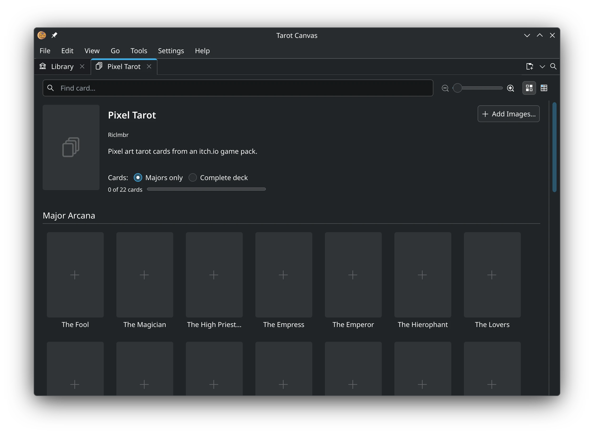
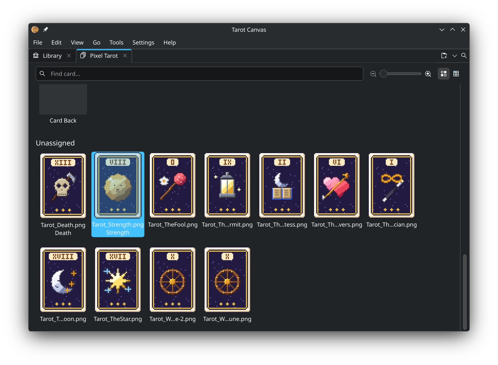
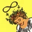
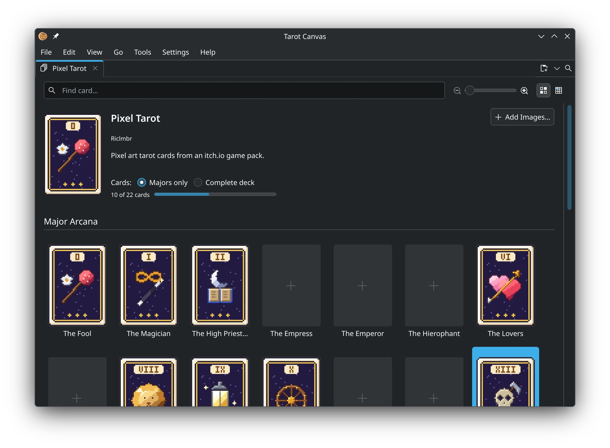
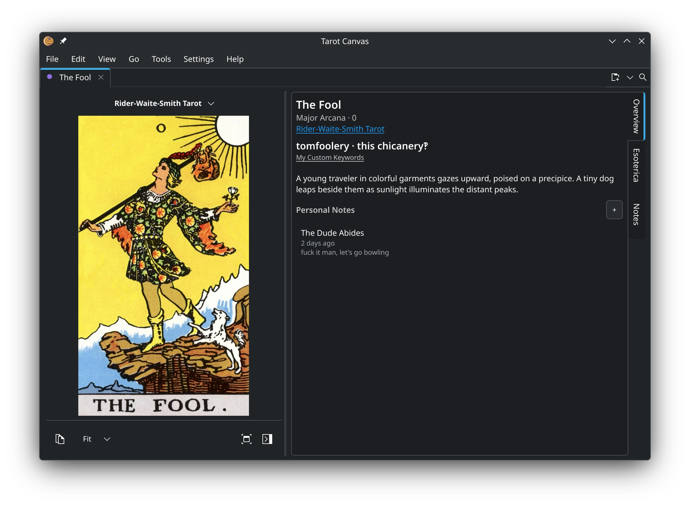

# Frequently Asked Questions

## Where can I get other tarot decks?

We provide a small number of free tarot decks (as of 2026, four) in our [Reference Deck Collection](https://github.com/arcanaland/reference-decks/releases). They are all available for download directly in the Tarot Canvas app.

Because there are only a handful of tarot decks in existence that are verifiably free from copyright claim, we are only able to provide a small sample of decks that are permissively licensed. For other decks, you can create your own by following the next section.

## How do I make my own deck?

Starting with version 1.10, you can create decks directly in the app by providing your own image files.

Select `File > New Deck...` from the menu bar and enter the name of your deck. For this example, I'll be creating a deck named "Pixel Tarot" using assets from the artist [Riclmbr](https://riclmbr.itch.io) on Itch.io.



Once created, you can either manually add images by clicking cells for individual cards, or you can bulk add images, which places them in the unassigned tray at the bottom of the deck.



Based on filenames, we will automatically try to guess the appropriate card. For example, the file `Tarot_Strength.png` is associated with the <span class="card">{ .card-icon } Strength</span> card and double-clicking it confirms the assignment.

For images whose cards could not be automatically inferred, you can right click on them to manually assign them.



Once you've finished assigning all of your images, you can finalize your deck and begin using it in your own readings. You can even export the deck into a zip file that can be shared with friends (but please make sure you have permission if using other people's art!).

!!! note
    For details about the underlying file format and how to fully customize your own tarot decks, please refer to the complete [Tarot Deck Specification](https://github.com/arcanaland/specifications/blob/main/DECK.md) ([PDF](https://github.com/arcanaland/specifications/releases/download/deck%2Fv2.0-rc.1/deck-v2.0-rc.1.pdf)).

## How do I add my own keywords for cards?

You can add your own esoterica by manually creating a TOML file with the following format:

```toml
[meta]
name = "My Custom Keywords"
identifier = "land.arcana.private/esoterica/my-keywords"
schema_version = "1.0"
version = "1.0"

# keywords for The Fool
[card."major_arcana.00".passages]
keywords = ["tomfoolery", "this chicanery‽"]

# keywords for the Eight of Wands
[card."minor_arcana.wands.eight".passages]
keywords = ["fast movement", "rain of arrows"]
```

!!! note
    The `major_arcana.00` syntax (called a *canonical identifier*) is defined in the [Technical Concepts](../../concepts) section and a full list of valid identifiers is provided.  


Save your `.toml` file in the directory `~/.var/app/land.arcana.TarotCanvas/data/tarot/esoterica/`.





!!! tip
    See the official [Esoterica Specification](https://github.com/arcanaland/specifications/blob/deck-v2/ESOTERICA.md) for the full list of supported fields for esoterica packs.
