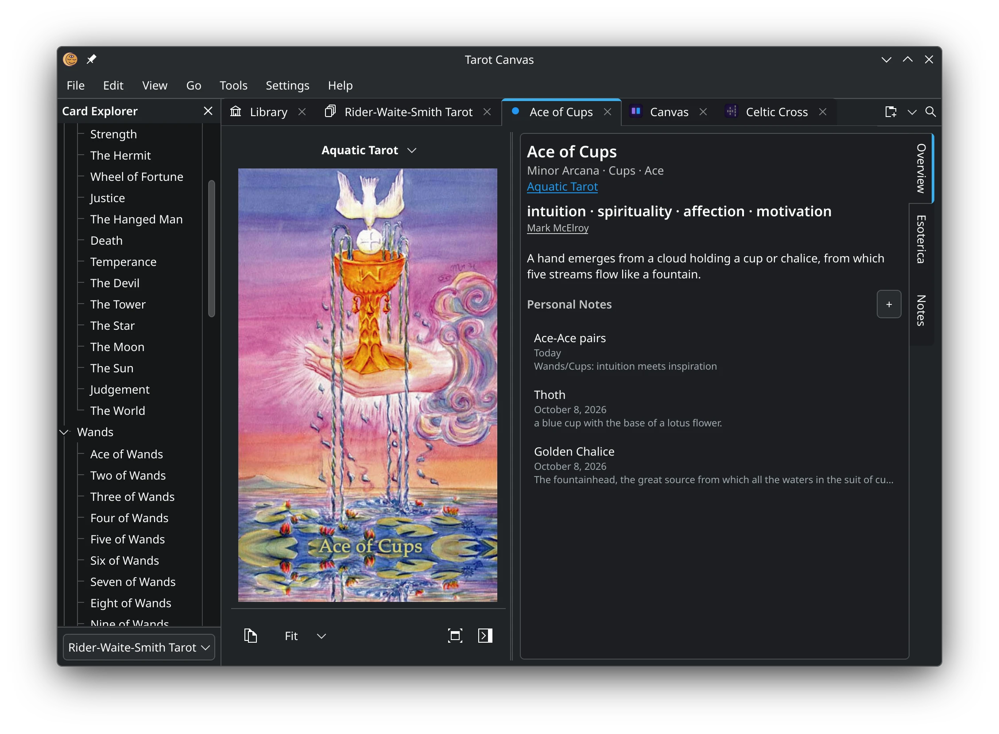

# Overview

Tarot Canvas is a desktop application for exploring all things tarot!

Features:

- Discover tarot decks and study card meanings.
- Perform tarot readings using your library of decks and spreads.
- Create your own spreads and arrange tarot cards from any deck on a virtual canvas.
- Add your own personal decks by following a simple tarot deck format.

## Installation

The preferred installation method on Linux is from Flathub:

### macOS / Windows

Coming soon!
